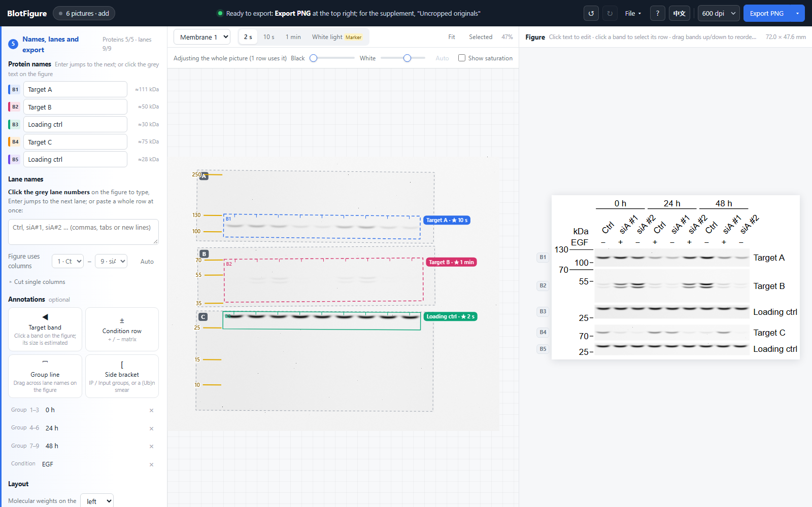
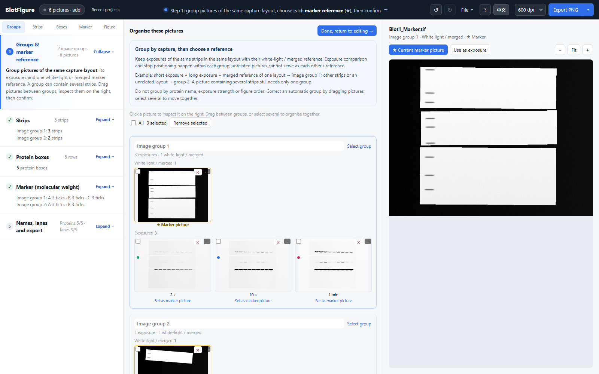

<div align="center">

# BlotFigure

**Turn the raw pictures of a Western blot experiment into a publication-ready figure — in your browser, offline.**

[**Download the single HTML file**](https://github.com/poplarity/BlotFigure/releases/download/v0.12.1/BlotFigure-v0.12.1.html) · [Use online](https://poplarity.github.io/BlotFigure/) · [中文说明](README.zh-CN.md)

[](https://github.com/poplarity/BlotFigure/actions/workflows/ci.yml)
[](LICENSE)


</div>

## Quick start

**Download one file, open it in your browser, and start making your figure. No installation, ZIP extraction or GitHub account is needed.**

1. **[Download BlotFigure-v0.12.1.html](https://github.com/poplarity/BlotFigure/releases/download/v0.12.1/BlotFigure-v0.12.1.html)** (about 800 KB). Save it to your Desktop or Downloads folder.
2. **Double-click the downloaded file.** It opens in your browser. If a text editor opens instead, right-click → **Open with** → Firefox, Chrome, Edge or Safari.
3. **Drop in all pictures of one experiment**: every exposure of each membrane plus a picture that shows the marker (the white-light picture, or white light merged with chemiluminescence). Then follow the 5 steps on the left and choose **Export PNG**.

That one HTML file is the complete tool. Keep it on your computer or send the same file to a colleague. Once downloaded, it works without an internet connection.

**Get the right file:** choose the release attachment named **BlotFigure-v0.12.1.html**, not the repository's **index.html**, **Source code (zip)** or **Source code (tar.gz)**. If you reach the [release page](https://github.com/poplarity/BlotFigure/releases/latest), expand **Assets** and click the file ending in **.html**.

**Keep your work:** use **File → Save project** (Ctrl+S) before closing. Your **.blotfig** file contains all the pictures and every adjustment; reopen it in BlotFigure to continue, on any computer.

**Prefer the website?** [Open BlotFigure online](https://poplarity.github.io/BlotFigure/). Try **Try the example** first: a membrane cut into three strips with three exposures, and a second membrane lying askew.

Need help? See [the download and opening guide](docs/getting-started.md) or press **?** inside the app.



Drop in everything the imager saved for one experiment. BlotFigure tells exposures from marker pictures, groups matching captures and exposures (also allowing aligned pictures taken after movement), finds the strips of a cut membrane and their tilt, makes one box per protein, picks the best exposure for every row (no saturation, enough signal), and lays the rows out as one figure with lane names, molecular-weight ticks and protein names. You confirm each step, mark the ladder bands with a few clicks and type the names. Everything happens in the browser; **nothing is uploaded, nothing is installed**.

<p align="center"></p>



## Contents

- [Features](#features)
- [Quick start](#quick-start)
- [The five steps](#the-five-steps)
- [Versions](#versions)
- [Privacy](#privacy)
- [Supported input](#supported-input)
- [What is detected automatically](#what-is-detected-automatically)
- [Exports](#exports)
- [Image integrity](#image-integrity)
- [Built-in ladders](#built-in-ladders)
- [Browser support](#browser-support)
- [Known limitations](#known-limitations)
- [Development](#development)
- [Contributing](#contributing) · [Citing](#citing) · [Acknowledgements](#acknowledgements) · [License](#license)

## Features

- **Photo workspace**: step 1 puts grouped thumbnails in the centre and a zoomable picture on the right, with direct marker/exposure controls and multi-select drag between groups.
- **Local history and presets**: new experiments keep previous projects in a browser-local library. Fonts, layout, export options and marker models can be saved as named presets. Save a `.blotfig` file for another computer or a durable backup.
- **Custom markers**: paste sizes, or import TXT/CSV/JSON; check a preview and save. Custom definitions travel with project files.
- **A whole experiment at once**: all exposures of all membranes and their white-light pictures in one drop; each picture is sorted by kind (exposure / marker picture) and by membrane.
- **Cut and tilted membranes**: the strips of a cut membrane are found on the marker picture with their own angle; boxes level themselves along their bands and can be turned by hand to a tenth of a degree.
- **Membranes moved between captures** (substrate added, strips lifted and put back) are recognised as one membrane and aligned, as a whole or strip by strip, and can be adjusted by hand.
- **The best exposure per row**: every protein row gets its own exposure (no saturated pixels in the band, enough signal, clean background), with a side-by-side comparison of all exposures and saturated pixels in red.
- **Known lane count**: enter the total lanes per protein box in step 2 (include marker and empty lanes inside that box). Detection and new boxes use that count, with positions fitted locally. Leave blank for automatic counting. In step 3, change a single box or explicitly apply the default count to existing boxes. The default is saved with projects and parameter presets; projects also retain each box’s override.
- **Boxes you can put anywhere**: resize, move, tilt; the figure shows exactly what a box covers. Lanes as in GelFigure: drag the first and last lane onto their lanes and the others spread evenly.
- **Arrange independent boxes**: drag rows up and down; drag each box left or right without moving other boxes on its membrane. Each detected protein region stays independent. Vertical dragging only reorders; dropping onto another row never combines it.
- **Optional columns in one WB figure**: each column has its own title (top or bottom), lane names, range and conditions. Move a region across by dragging or its ⋯ menu; exposure and levels remain independent. Top alignment by default, optional row alignment, adjustable spacing.
- **Marker by hand, in a few clicks**: choose the ladder once (40 prestained ladders with their reference bands), click the bands you can see. One mark displays a tick; two or more enable size estimates and hints for the remaining bands.
- **Edit on the figure**: click a lane or protein name and type, Enter jumps to the next; group lines, +/− condition rows, target-band arrows with estimated sizes, side brackets for IP / Input groups or (Ub)n smears, `*` / `#` / `†` marks.
- **Marker display**: one global font for all labels, with short ticks at their actual positions. Overlaps are checked using glyph heights; numbers are never moved into extra columns. Fit the font or hide unneeded numbers without deleting calibration.
- **Conditions from Excel**: paste tab-separated rows (condition name, then one cell per visible lane), append or replace the current column; blanks and arbitrary time/dose values are preserved. Shift+click a cell to edit text. Side labels support vertical text and straight lines.
- **Flexible labels**: group labels wrap, shrink or stay on one line; every label can have its own font size; protein names and molecular weights can each go on the left or right.
- **Pre-flight check before export**: unnamed rows, saturated exposures, tiny fonts, effective resolution below 300 dpi, a figure wider than a double column, with one-click fixes.
- **Reproducible**: project files with every picture's SHA-256, a processing log, the uncropped originals for the supplement, reusable style files, and a local history of projects that survives a page reload.
- **Bilingual interface**: English and Chinese, switchable at any time. Type figure labels in your preferred language.

## The five steps

To rerun detection, open **Strips**, edit outlines/counts and click **Detect this group again**. This replaces the group’s boxes and edits; Ctrl+Z restores them. **Keep existing boxes, return to editing** is a separate action.


Follow the sequence once for a new experiment. Afterwards use each tool’s **Expand / Collapse** button directly; switching tools applies pending strip edits and preserves existing regions, including your deletions. In the protein tool, **Add a protein box** is at the top. Click a box and press **Backspace** to remove just that box; text editing keeps normal keyboard behavior.

1. **Groups & marker reference** — put exposures of the same strips in the same capture layout with their white-light / merged reference. One group can contain multiple strips. Exposure comparison and strip positioning happen within the group. Use separate groups for unrelated strips/layouts, not different proteins, brightness levels or figure order. Drag to correct a group, then select its ★ reference.
2. **Strips** — the blue boxes are the strips found on the marker picture. Move, resize, rotate, draw or delete them right on the picture. Set the expected lanes per protein box here before generating the boxes.
3. **Protein boxes** — one box per protein, and the figure appears on the right. Resize, move or tilt a box; drag the leftmost and rightmost lane lines onto the lanes; add a box for a protein that was missed.
4. **Marker** — choose your ladder and click its bands on the marker picture (they snap); one mark displays its known size; two or more allow estimates for the other bands.
5. **Names, lanes and export** — protein and lane names (on the figure or pasted as a row), annotations, layout; then **Export PNG**, TIFF or SVG.

### Optional column layout

In step 5 choose **Add a layout column**, then drag regions into it or use **⋯ → Move to column**. Switch the column tabs before filling lane names or pasting conditions. The column’s title can sit above or below it. **Column settings** holds spacing, row alignment and label copying; empty columns are omitted from export. This is a lightweight arrangement of WB regions within one figure, with no whole-paper panel canvas.


## Versions

The current version is **0.12.1**: local-signal region detection fixes excessive blank/overlapping boxes at small lane counts. Return to strip review, adjust settings and explicitly detect that group again, or keep existing boxes. Reruns are undoable and leave other groups unchanged. See the [changelog](CHANGELOG.md).

## Privacy

BlotFigure is a static web page with no backend. Pictures are decoded and processed by JavaScript in your browser, and results are saved by your browser's own download mechanism.

The page carries a [Content Security Policy](index.html) that **forbids it from connecting to any other server** (it may only load its own files), so this is enforced by the browser, not just promised. The only data kept on your computer are preferences, custom ladders and the local project library in IndexedDB.

## Supported input

| Format | Notes |
|---|---|
| TIFF (8 / 16 / 32-bit grayscale, or RGB) | Recommended: the 16-bit TIFFs chemiluminescence imagers export. Uncompressed, LZW, Deflate and PackBits; little- and big-endian. RGB pictures (e.g. a merged marker picture) are read as gray. |
| PNG / JPG / BMP | Read as 8-bit by the browser; a note suggests the raw 16-bit TIFF instead (saturation is hard to judge in 8 bits). |
| `.blotfig` | BlotFigure project file. |

Exposures are recognised by their file names (`Chemi`, `ECL`, `_30s`, `2min` …) or, failing that, by the picture itself; marker pictures by names such as `Marker`, `White`, `Merge`, `Overlay`, or by a large bright membrane on a dark tray.

## Independent editing, without joining

- New detected regions stay separate, even when pieces have matching heights or similar signal strength.
- Drag vertically to reorder only. There is no drop-to-merge gesture.
- Changing one region's exposure or brightness leaves other regions unchanged. Existing automatic image display ranges stay fixed; whole-exposure adjustments require explicitly choosing the advanced control.
- An old project keeps its layout on opening. Step 3 shows any legacy binding and offers **Detach and edit separately** or **Detach all**. This retains the currently displayed settings; it cannot reconstruct choices that an old merge already overwrote.
- Fragments made by omitting an internal marker lane from a single original protein region remain that one region, with a visible gap. This is distinct from joining unrelated protein regions.

## Fast image organisation and independent crops

- Step 1 reads and groups pictures first. Alignment and strip analysis wait until you confirm the groups.
- Drag thumbnails between image groups (select several to move them together), or drop on **New image group**. Each thumbnail has a remove button; **Remove selected** works in bulk. Ctrl+Z restores removed pictures.
- Every protein box has its own **B1, B2, …** ID. It moves independently, including when several crops share one physical strip. Independent regions are never joined. For legacy combined rows, step 3 offers **Detach and edit separately** or **Detach all**, preserving current exposures, levels, names and crop bounds.
- Weak detected rows stay visible. Hide them explicitly if unwanted; hidden rows have a **Show** button and **Show all hidden boxes** restores them together.
- An excluded internal marker lane produces separate editable source boxes. Their splice gap appears only in that row. **Include middle lanes; restore continuous box** undoes a mistaken exclusion.
- Set the lane count directly, then drag the two end lane lines. No extra spacing button is needed; automatic detection is still available as a fallback.
- A single manual marker mark is sufficient to display that tick. Other molecular weights are estimated only after two marks. Crowded ticks stay in one label column; reduce the global font or hide unneeded numbers. No calibration is removed.

## What is detected automatically

| Step | How |
|---|---|
| Exposure or marker picture | File name first; otherwise the picture: a white-light picture is a large bright membrane on a dark tray, an exposure is mostly background with bright bands. 16-bit files that use a small part of the range are stretched first. |
| Exposure time | Read from the file name (`_30s`, `_2min`, `500ms`). Without that information, pictures are compared by signal quality; the actual exposure time remains unknown. |
| Membrane | Exposures are grouped by correlation, marker pictures by the outline of the membrane. |
| Membrane moved between captures | White-light pictures that match after a shift and rotation (as a whole, or strip by strip) are taken as one membrane; every picture is aligned to the position most of them share. Exposures alone are never merged automatically (different membranes probed for the same protein look alike). |
| Strips | Segmented on the confirmed marker picture, each with its angle; without one, from the signal regions. |
| Protein rows | One row per protein (a doublet such as p-ERK1/2 is one row); separate source regions are never combined based on height or strength. Each box levels itself along its bands (robust slope over at least 3 clear lanes). |
| Best exposure per row | Scored per row without needing exposure times: no saturation inside the band, enough signal, clean background; a saturated exposure is used only when there is no suitable unsaturated one, prioritising the least clipping. |
| Lanes | Every box has its own lanes, read from the membrane's lane spacing and the box's own pixels; noise and the two edges of one band never count as extra lanes; empty slots between lanes still count. |
| Figure columns | Initial columns follow the detected lane positions and can be adjusted per region. Matching columns never bind exposure or level settings. |
| Contrast | One linear adjustment per picture, background kept light grey; the white point is set from the pixel noise, so a smear never pushes strong bands to grey. Per-row levels are possible and stated in the legend. |
| Molecular weights | **Not read automatically** (missing, faint or cut marker bands make a wrong automatic scale harder to fix than marking by hand): you click marker bands, which snap; after two marks per strip the other sizes are shown where they are expected. Row sizes are interpolated between neighbouring ticks. |

## Exports

| Export | Content |
|---|---|
| PNG | Rendered at the chosen dpi (300 / 600 / 1200). Includes `pHYs` (resolution), `sRGB` and an embedded processing summary (`iTXt`, UTF-8). |
| TIFF | 8-bit grayscale, LZW, with resolution tags and the processing summary. For journals that accept only TIFF. |
| SVG | Vector text and lines; edit in Illustrator or Inkscape. |
| Uncropped originals | Every exposure and marker picture used, as taken (not aligned or rotated), with each box, its lanes' figure columns and the protein names drawn where the bands really are. For the supplementary information. |
| Processing log (JSON) | Each source's SHA-256, alignment, every row's boxes, lanes, exposure, levels and tilt, all layout parameters, legend notes. |
| Densitometry (CSV) | Band volumes minus local background on the exposure shown, normalised to the loading control on the same membrane; saturated values flagged `SAT`. |
| Legend text | Suggested legend notes: membranes, inversion, ladder, exposure of every row, cut lanes, symbols. |

The **Layout** section shows the **effective resolution** of the bands themselves (picture pixels per lane ÷ printed lane width). If it is below 300 dpi, BlotFigure tells you the widest lane that keeps 300 dpi and offers to apply it. The total figure width can be set directly to a journal column (85 / 120 / 180 mm).

## Image integrity

BlotFigure follows common journal image policies (e.g. Nature, JBC, PLOS; see Rossner & Yamada, *J Cell Biol* 2004, "What's in a picture?"):

- Only **linear** adjustments, whole-picture by default; a row adjusted on its own is stated in the legend notes.
- **One picture per row**: exposures or membranes are never spliced within a row. Lanes cut from a layout column are cut from every row in that column and leave a visible gap; neighbouring columns that are not neighbours on the membrane are separated too.
- **Saturated** exposures are flagged and never chosen while an unsaturated one has enough signal; the loading control should be on the same membrane, and the tool checks it.
- Every export carries a processing summary; the uncropped originals and the processing log are there for the supplement and for reviewers.

BlotFigure helps you comply, but **you remain responsible** for following your journal's policy.

## Built-in ladders

**40 prestained protein ladders** (kDa, apparent molecular weights): Bio-Rad Precision Plus (Dual Color, All Blue, Kaleidoscope, Dual Xtra) · Thermo / Invitrogen (PageRuler, PageRuler Plus, Spectra, Novex Sharp, SeeBlue Plus2, MagicMark XP) · NEB · Abcam · GenScript · Amersham · LI-COR · Yeasen · Epizyme · Beyotime · TransGen · Solarbio · Sangon · Tiangen · Vazyme. The list shares its sizes and reference bands with GelFigure; [`docs/ladders.md`](docs/ladders.md) lists each with its catalogue number. Prestained sizes are calibrated in a Tris-glycine system and shift with gel percentage and buffer, so a size read from one is an estimate; the legend says "apparent molecular weights".

Any other ladder can be added as a custom ladder in step 4. To add a ladder for everyone, see [CONTRIBUTING.md](CONTRIBUTING.md).

## Browser support

Current Chrome, Edge, Firefox and Safari 16.4+ on Windows, macOS and Linux, with a mouse (there is no phone layout). The test suite runs in Chromium, Firefox and WebKit on every change.

When the downloaded HTML is opened directly from disk, some browsers disable IndexedDB for local files; the local project library may be unavailable. Use the online version or "Save project" if you need it.

## Known limitations

- Detection has been developed on real chemiluminescence blots and on synthetic membranes. If detection fails on your pictures, please [open an issue](https://github.com/poplarity/BlotFigure/issues/new/choose) (only with pictures you may share).
- Densitometry is for orientation; quantify on at least three independent experiments with a dedicated tool for publication.
- Bio-Rad `.scn` / `.1sc` and other proprietary formats must be exported to TIFF first. BigTIFF and palette TIFFs are not supported. 16-bit PNGs are read as 8-bit by browsers.
- No phone or tablet layout yet.

If the page looks like plain text and unstyled buttons, its stylesheet has not loaded. Reload with Ctrl+Shift+R (Command+Shift+R on macOS). For offline use, download the **single-file HTML** from [Releases](https://github.com/poplarity/BlotFigure/releases/latest), or extract the **whole ZIP** and keep `css/` and `js/` beside `index.html`.

## Development

This section is for contributors editing the source. To use BlotFigure, follow the single-file download steps above.

No build step and no dependencies: the app is plain HTML, CSS and JavaScript loaded with ordinary `<script>` tags, so it also runs from `file://`.

```
index.html          the page
css/style.css       styles
js/storage.js       optional preferences with in-memory fallback
js/i18n.js          interface language (L('中文', 'English') pairs)
js/tiff.js          TIFF decoder                 js/engine.js     shared image helpers (from GelFigure)
js/wbengine.js      blot analysis: kinds, membranes, strips, rows, lanes, ladder fit, exposures, registration
js/wbladders.js     prestained ladder library    js/wbdemo.js     synthetic demo membranes
js/wbapp.js         state, undo, projects, alignment, rows and boxes, checks, processing log
js/wblibrary.js     cached projects and parameter presets
js/wbextras.js      history/preset dialogs, marker import and photo browser
js/wbrender.js      figure layout (SVG)          js/export.js     PNG / TIFF / SVG export
js/wbview.js        the membrane view            js/wbui.js       steps panel, editing on the figure
test/*.html         engine self-tests on synthetic membranes
tests/run.mjs       runs everything in Chromium, Firefox and WebKit
scripts/            single-file build, release notes
```

Run the tests:

```bash
npm install
npx playwright install chromium firefox webkit
npm test                      # all three engines
npm test -- --browser=chromium
npm run build                 # dist/BlotFigure.html, the single file
```

[DEVELOP.md](DEVELOP.md) (in Chinese) lists the debugging URL parameters, the test pages and the data model.

## Contributing

Bug reports, blot pictures that break detection (only if you are allowed to share them), new ladders, translations and code are welcome. See [CONTRIBUTING.md](CONTRIBUTING.md).

## Citing

If BlotFigure helped with a publication, please cite it; see [CITATION.cff](CITATION.cff) or use GitHub's "Cite this repository" button.

## Acknowledgements

BlotFigure is designed and developed by [poplarity](https://github.com/poplarity). It is the sibling of [GelFigure](https://github.com/poplarity/GelFigure), whose TIFF decoder, export code and ladder list it shares.

Development is supported by API tokens provided by **Zhao Bowen** ([@zhober](https://github.com/zhober)).

## License

[MIT](LICENSE)
