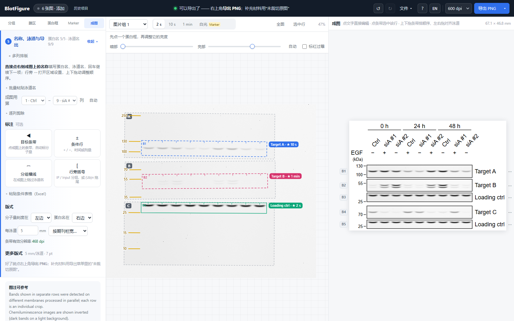
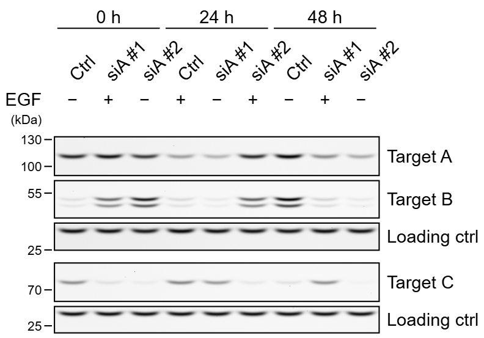
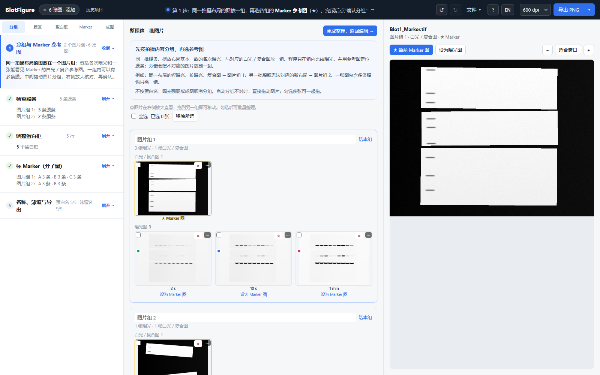
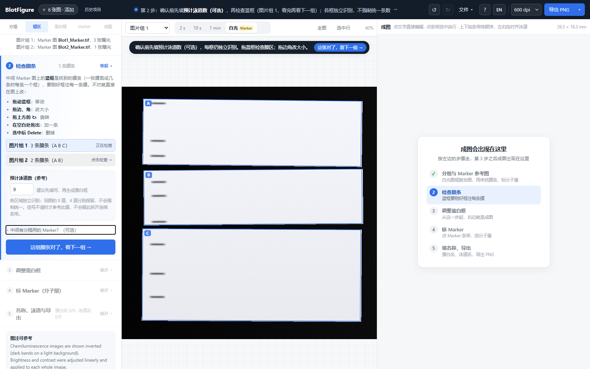
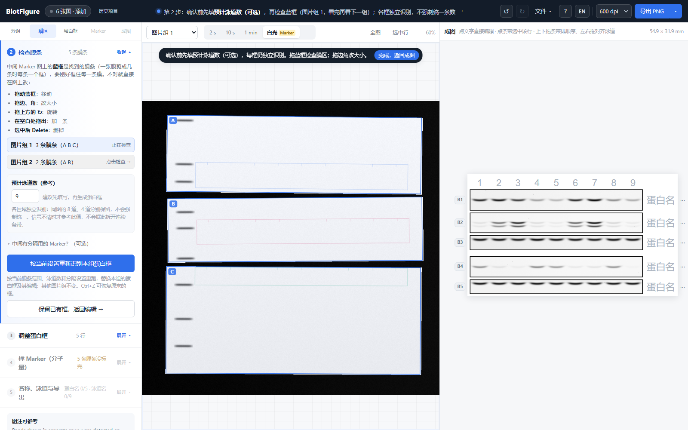
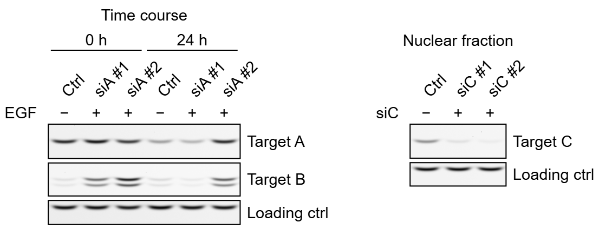
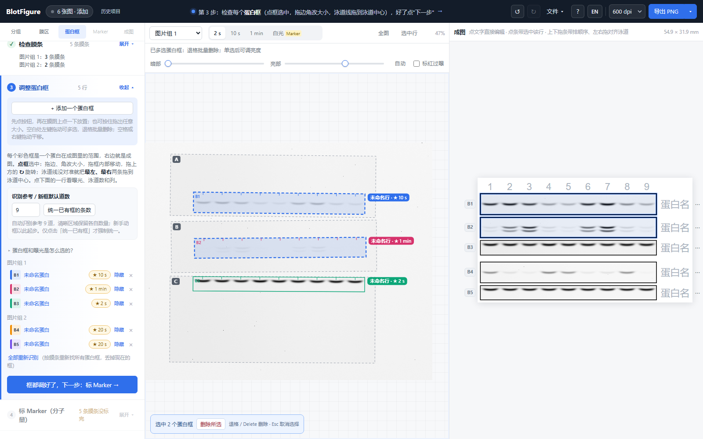

<div align="center">

# BlotFigure

**把一次 Western blot 实验的原始图片做成可投稿的成图 —— 在浏览器里完成，离线可用。**

[**下载单文件 HTML**](https://github.com/poplarity/BlotFigure/releases/download/v0.13.0/BlotFigure-v0.13.0.html) · [在线使用](https://poplarity.github.io/BlotFigure/) · [English](README.md)

[](https://github.com/poplarity/BlotFigure/actions/workflows/ci.yml)
[](LICENSE)


</div>

## 快速开始

**只需下载一个文件，用浏览器打开就能做图。不用安装、不用解压，也不用注册 GitHub。**

1. **[点击下载 BlotFigure-v0.13.0.html](https://github.com/poplarity/BlotFigure/releases/download/v0.13.0/BlotFigure-v0.13.0.html)**，约 800 KB，保存到桌面或"下载"文件夹。
2. **双击刚下载的文件。** 它会在浏览器中打开；如果打开的是记事本等软件，右键文件 → **打开方式** → 选择 Firefox、Chrome、Edge 或 Safari。
3. **把一次实验的全部图片拖进去**：每张膜的各次曝光，加上一张看得见 Marker 的图（白光图，或白光 + 化学发光的复合图）。然后按左边的 5 步走，最后点 **导出 PNG**。

这一个 HTML 文件已经包含完整界面和处理功能。保存后可以断网使用，也可以把同一个文件直接发给同事。

**认准文件名：** 下载的是 **BlotFigure-v0.13.0.html**，不是仓库里的 **index.html**，也不是 **Source code (zip)** 或 **Source code (tar.gz)**。如果进入了[版本下载页](https://github.com/poplarity/BlotFigure/releases/latest)，展开 **Assets（附件）**，只点结尾为 **.html** 的文件即可。

**下次接着做：** 关闭前点 **文件 → 保存项目**（Ctrl+S）。得到的 **.blotfig** 项目文件包含全部图片和所有调整，下次用 BlotFigure 打开即可继续，换电脑也行。

**也可在线使用：** [打开 BlotFigure 网页版](https://poplarity.github.io/BlotFigure/)。可以先点 **看看示例**：一张切成 3 条、拍了 3 个曝光的膜，加上另一张斜着放的膜。

详细步骤见[下载与打开图解](docs/getting-started.zh-CN.md)，工具内点 **?** 也可查看帮助。



把成像仪为一次实验存下的图片全部拖进去：BlotFigure 区分曝光图和 Marker 图，按拍摄布局归组（拍摄之间膜挪动过也能认出并对齐），找出切开的膜条和各自的倾斜角度，每个蛋白生成一个框，为每一行挑最合适的曝光（不过曝、信号够），再排成一张带泳道名、分子量刻度和蛋白名的成图。每一步由你确认，点几下标好 Marker，填上名字即可。所有处理都在浏览器里完成，**不上传、不安装**。

<p align="center"></p>

## 目录

- [功能](#功能)
- [快速开始](#快速开始)
- [五个步骤](#五个步骤)
- [常见操作](#常见操作)
- [版本](#版本)
- [隐私](#隐私)
- [支持的输入](#支持的输入)
- [自动识别了什么](#自动识别了什么)
- [导出](#导出)
- [图像规范](#图像规范)
- [内置 Marker](#内置-marker)
- [浏览器支持](#浏览器支持)
- [已知局限](#已知局限)
- [开发](#开发)
- [参与贡献](#参与贡献) · [引用](#引用) · [致谢](#致谢) · [许可证](#许可证)

## 功能

- **一次处理整个实验**：所有膜的所有曝光和白光图一次拖入，自动分出曝光图 / Marker 图，并按拍摄布局归组。
- **切开、放歪的膜**：在 Marker 图上分割出每一条膜条和各自的角度；蛋白框按条带自动摆正，也可以手动微调到 0.1°。
- **拍摄之间膜挪动过**（补底物、膜条拿起来又放回去）：认出是同一张膜并对齐，整张膜一起或每条膜条各自对齐，也可以手动调。
- **每行挑最合适的曝光**：每个蛋白单独选曝光（条带内不过曝、信号够、背景干净），可以并排比较全部曝光，过曝像素标红。
- **框可以放在任何位置**：缩放、移动、倾斜，框住哪里成图就显示哪里。泳道和 GelFigure 一样：把首尾两条泳道线拖到泳道上，中间的自动均匀排开。
- **用鼠标排版**：上下拖行调顺序，左右拖对齐剪开的膜条的泳道；落在另一行上也只排序，不会拼接。
- **一张 WB 图内分列**：每列分别填写标题（上方或下方）、泳道名称、范围和条件。拖动区域到另一列，或在名称旁 ⋯ 中选择；曝光、亮度保持独立。默认顶部对齐，可选按行对齐、调整间距。
- **Marker 手动标，点几下就好**：选一次型号（40 种预染 Marker，含参考带），只标看得见的条带；1 条能显示刻度，2 条以上才估算其他分子量。
- **在成图上直接编辑**：点泳道名、蛋白名直接输入，回车跳下一个；分组横线、+/− 条件行、自动标分子量的目标条带箭头、IP / Input 分组或 (Ub)n 拖尾的行旁括号、`*` / `#` / `†` 标记。
- **Marker 字号和显示**：所有区域统一字号，固定短刻度对准原位置；用实际字形高度检查重叠，不延长或错列。可统一适配字号，或隐藏次要数字，校准点仍保留。
- **Excel 条件表**：第一格条件名，后面每格对应一条显示的泳道；支持追加、替换本列，保留空格和时间/剂量文字。Shift+点击成图格子可编辑任意值。侧边括号支持竖排文字与直线。
- **灵活的文字排版**：分组文字放不下时自动换行、缩小或保持一行；每一项都能单独设字号；蛋白名和分子量可以分别选放左边或右边。
- **导出前检查**：没填名字的行、过曝的曝光、太小的字、低于 300 dpi 的有效分辨率、超过双栏宽度，能改的一键修正。
- **可追溯、可复现**：项目文件记录每张图的 SHA-256，处理日志、补充材料用的未裁切原图、可复用的样式文件，刷新后还能恢复的自动草稿。
- **中英双语界面**：随时切换。成图标签可按需要使用中文或英文。

## 相册、历史项目与预设

第 1 步在中间拖动图片分膜组，右侧放大查看并指定 Marker 图／曝光图。返回修改时保留已有蛋白框。

新实验用「文件 → 新建」或拖入图片后选「另建项目」，上一批自动保留在历史项目中。点顶栏的「历史项目」即可再打开；支持改名和删除。缓存属于当前浏览器，清理浏览器数据会清除缓存；换电脑、留备份请用 .blotfig 项目文件。

「文件 → 参数预设」保存字号、版式、导出参数和 Marker 型号；可命名、套用、导出和导入。自定义 Marker 在第 4 步直接粘贴条带数字，或导入 TXT/CSV/JSON，预览后保存即可。



## 预计泳道数作为参考

第 2 步可先填写「预计泳道数（参考）」。每个区域独立识别，同一张图里的 8 道、4 道分别保留；预设不强制统一，也不用于机械拆框。清晰图像与参考值不符时会提示核对，信号不清时才参考预设。中间有 Marker 时仍可手动指定分隔泳道，或自己框选需要的区域。

第 3 步新加的手动框以预设数量起步；不同的框可单独修改。修改默认数量不会改动已有框，需要时点「统一已有框的条数」。清空全部框再添加，会自动恢复新框所需的完整预览范围。



## 五个步骤

需要重做自动识别时，展开「检查膜条」，调整蓝框和泳道数，再点「按当前设置重新识别本组蛋白框」。这会替换本组框及编辑，可 Ctrl+Z 恢复；只想回去看看或改膜框而保留蛋白框，用「保留已有框，返回编辑」。



新实验先按顺序确认；之后用各栏的「展开／收起」直接切换工具，修改会保留，无需重新走流程。「添加蛋白框」在第 3 栏顶部；选中蛋白框后按退格只删这个框，编辑文字时正常删字。

1. **分组与 Marker 参考图** —— 同一拍摄布局的各次曝光和白光／复合参考图放一个图片组，一组可包含多条膜。组内比较曝光、定位膜条；换一批膜或无法对应的布局另建组，不按蛋白名、曝光强弱或成图顺序分。拖动纠正分组，再为各组选择标 ★ 的参考图。
2. **检查膜条** —— 蓝框是在 Marker 图上找到的膜条，直接在图上移动、缩放、旋转、新画或删除。
3. **调整蛋白框** —— 每个蛋白一个框，右边出现成图。缩放、移动、倾斜框；把最左、最右两条泳道线拖到泳道上；漏了的蛋白加一个框。
4. **标 Marker** —— 选你用的型号，在 Marker 图上点它的条带（自动吸附）；1 条也能显示刻度；2 条以上才估算其他条带的分子量。
5. **名称、泳道与导出** —— 蛋白名、泳道名（在成图上输入或整行粘贴）、标注、版式；然后 **导出 PNG**、TIFF、SVG 或 [可编辑 PPTX](docs/pptx.md)。

第一次打开会有一个三栏的简短引导（"?" 里可以再看一遍）。

## 可选多列排版

第 5 步点 **多列排版**，把区域拖入新列，或在蛋白名称旁 **⋯ → 移到排版列**。先选列标签，再填该列的泳道名、粘贴条件表；标题可放在顶部或底部。「列设置」可改间距、按行对齐、复制标签；空列不导出。它只负责同一张 WB 图中的区域排布，保持轻量。



## 常见操作



**多选删除**：常规编辑时在原图空白处左键拖出选择框；Ctrl/⌘/Shift 点击可增减选择。按退格或 Delete 批量删除，Ctrl/⌘+Z 一次恢复。空格或右键拖动用来平移；在文字框中输入时不会删蛋白框。

**自定义 Marker 重复使用**：保存后从第 4 步列表顶部「我的 Marker」选择。缓存属于当前浏览器与站点；换电脑或换离线文件环境，可在「自定义 Marker」里备份为 JSON 后导入。

- **框的范围不合适**（第 3 步）：在中间膜图上点框选中这一行，拖四条边或四个角自由缩放：框里的泳道留在原处，拖出去的地方按同样的间距补上泳道；拖框内部移动，可以拖到任何位置，包括别的膜条上（框就归那条膜条，分子量按它的 Marker 算）；按住 Shift 只上下移动这一行在各条膜条上的框。
- **泳道对不上**（和 GelFigure 一样的"首尾泳道等间距"）：把框里最左、最右两条泳道线拖到泳道中心，中间的泳道均匀排开（按住 Alt 只动这一条）；条数不对就展开这一行，直接改泳道数（立即生效）。边缘条带被切掉一部分：把最外侧的泳道线往外拖。框上方数字是每一道在成图里的列（M = Marker 道，× = 不用，点数字切换）。多认了一道：点那根竖线按 Delete；漏了：双击框内加一道。列号错位：点 ‹ ›（最左到第 1 列，不会推动其他行）。
- **框歪了**：框生成时已按条带自动摆正；还不正就拖框上方的 ↻，或选中后按 [ ]（0.1°，Shift 1°），或在展开的行里点"倾斜 − +"；"按条带摆正"重新自动摆，"归零"回到和膜条一样的角度。
- **漏掉的蛋白**：点"+ 添加一个蛋白框"，鼠标移到膜上会看到一个虚线框跟着走，点一下就放下（和其他框一样大），也可以按住拖出任意大小。
- **膜条认错了**：回到第 2 步改，点"下一步"生效；已经调好的框都留在原处。
- **调整各行的上下顺序**：在成图上按住一行的条带上下拖；选中一行后 Alt+↑↓ 一次挪一位。
- **左右对齐泳道**（剪过的膜，比如膜条 A 的第 4–6 道要对准膜条 B 的第 1–3 道）：在成图上把一行左右拖，按列吸附，只移动当前蛋白框，同膜上的其他框不动。
- **旧版已经合并的区域**：第 3 步会提示旧版绑定，点"解除绑定，分别编辑"或"全部解除绑定"。沿用当前曝光、亮度、名称和裁切范围，再逐区调整。旧版合并时已经覆盖的独立设置无法自动找回。
- **膜的位置没对齐**：对齐过的图在缩略图上标"已对齐"。不准的话点那张图的 ⋯ →"手动对齐…"：拖动图片让条带落进框里，Shift+拖动或 [ ] 旋转，方向键微调；"不对齐"按原样使用。认错成同一张膜的，用"移到"把图移走。
- **标 Marker**（第 4 步）：先选型号；膜图右上角显示它的官方条带示意（橙色 = 彩色 / 加粗的参考带）。在 Marker 图上点一条 Marker 带、选分子量（推荐的高亮，回车即选），自动吸附到最近的条带，按住 Alt 不吸附。标满 2 条后，其余大小的位置用虚线提示，点一下就加上。拖刻度对准条带；点刻度上的数字改分子量或删除。
- **某个蛋白在这张曝光里太亮 / 太暗**：第 3 步点这一行，展开后点别的曝光（红色 = 过曝像素）；或选中这一行后拖膜图上方的"暗部 / 亮部"，只调这一行（线性调整，图注会说明）。
- **给某条带标分子量（目标条带）**：第 5 步"标注"里点"目标条带"，再在成图上点那条带：箭头吸附到条带上，按这条膜条标的 Marker 算出分子量（超出标过的范围时标 ≈）。点箭头可以加名称、填理论大小、换成 * # †、换边、删除；上下拖动可以移到这一行的另一条带。
- **IP / Input 分组、泛素化拖尾（行旁括号）**：第 5 步"标注"里点"行旁括号"，在成图上沿着行上下拖：盖住几行就是一组，在一行里拖一段就标出这一段；点一下盖住整行。松开后输入文字（↵ 换行）。
- **成图上的文字**：点泳道名、蛋白名、分组、条件直接改；编辑框下面的小条可以单独调字号（A− / A+ / 默认），分组文字可以换行（↵ 或 Shift+Enter）。`*斜体*` 用两个星号夹住（如 `*p*-ERK`）；单个的 *（如 `WT*`）照原样显示。
- **成图大小**：直接填每泳道宽度，或在"按期刊栏宽"里选单栏 85 / 1.5 栏 120 / 双栏 180 mm。下面一行显示条带本身的有效分辨率，低于 300 dpi 时提示每道最宽多少，并可一键改过去。
- **文件菜单**：保存 / 打开项目；刷新后从开始页恢复自动草稿；保存 / 载入样式（下一张同类的图一键套用）；回到刚导入时（可撤销）；新建。

## 版本

当前版本 **0.13.0**：各蛋白区域独立识别泳道数，预计条数仅作参考；新增框选多框批量删除，小屏亮度控件与浮窗适配，自定义 Marker 持久缓存和备份。详见[更新记录](CHANGELOG.md)。

## 隐私

BlotFigure 是一个没有后端的静态网页。图片由浏览器里的 JavaScript 解码和处理，结果通过浏览器自己的下载功能保存。

页面带有[内容安全策略（CSP）](index.html)，**禁止它连接任何其他服务器**（只能读取它自己的文件），这一点由浏览器强制执行，而不只是承诺。保存在你电脑上的只有偏好设置、自定义 Marker 和IndexedDB 中的历史项目。

## 区域独立，取消拼接

- 不同区域不再因为高度或信号相似而自动合成一行，上下拖动只改变顺序。
- 改一个区域的曝光或亮度不影响其他区域。自动生成的曝光图显示范围确定后保持稳定；全图调整需要明确选择高级选项。
- 旧项目不会在打开时被重新排版；第 3 步提示"旧版绑定"，可逐行或全部解除，保留当前图像设置。
- 同一原始蛋白区域去掉中间 Marker 泳道后留下的片段，仍属于这一个区域，并保留可见间隙；这不是把两个独立蛋白区域合并。

## 图片整理与独立蛋白框

- 第 1 步先读取和分组，确认后才对齐图片、分析膜条。缩略图直接拖到正确膜组，也能勾选多张一起移动或移除；Ctrl+Z 可撤销。
- 每个框有独立编号 B1、B2……；同一膜上的多个区域可以分别移动，各自选择曝光和亮度；不再拼成一行。
- 弱信号框默认显示，可手动隐藏。旧项目的隐藏框可以点「显示」，或「显示全部隐藏框」。
- 中间 Marker 泳道被排除时，原图上也拆成多个框，接缝只影响对应行。认错时点「包含中间泳道，恢复连续框」。
- 改泳道数立即均分，再拖首尾两条线对准中心，无需再点对齐按钮。
- 只标一条 Marker 就能显示其已知刻度；两条以上才估算其他分子量。拥挤刻度错列排布，不再被自动舍弃。

## 支持的输入

| 格式 | 说明 |
|---|---|
| TIFF（8 / 16 / 32 位灰度，或 RGB） | 推荐：化学发光成像仪导出的 16 位 TIFF。支持无压缩、LZW、Deflate、PackBits，大端和小端。RGB 图（如复合 Marker 图）按灰度读取。 |
| PNG / JPG / BMP | 浏览器按 8 位读取；会提示改用原始的 16 位 TIFF（8 位不好判断过曝）。 |
| `.blotfig` | BlotFigure 项目文件。 |

曝光图按文件名识别（`Chemi`、`ECL`、`曝光`、`_30s`、`2min` 等），看不出时看图；Marker 图按 `Marker`、`White`、`白光`、`Merge`、`复合`、`叠加` 等名称识别，或按"暗托盘上一大片亮的膜"识别。

## 自动识别了什么

| 步骤 | 做法 |
|---|---|
| 曝光图还是 Marker 图 | 先看文件名；看不出时看图：白光图是一大片亮的膜放在暗的托盘上，曝光图大部分是背景、只有条带亮。只用了很小一段灰度的 16 位文件先拉伸再判断。 |
| 曝光时间 | 从文件名读取（`_30s`、`_2min`、`500ms`）；读不到时按信号质量比较图片，不推算实际曝光时间。 |
| 归到哪张膜 | 曝光图之间做相关性比对，Marker 图按膜的轮廓匹配。 |
| 拍摄之间膜挪动过 | 白光图平移、旋转后能对上（整张或每条膜条分别对上）就认作同一张膜，每张图对齐到大多数图所在的位置。只有曝光图的不会自动并成一张膜（不同的膜做同样的蛋白，条带也一样）。 |
| 膜条 | 在确认的 Marker 图上分割，各自测角度；没有 Marker 图时按信号区域。 |
| 蛋白行 | 每个蛋白一行（p-ERK1/2 这样的双带算一行）；不同区域保持独立，不根据高度或强度判断它们是同一个蛋白。每个框按框里的条带自动摆正（至少 3 道清楚条带的稳健斜率）。 |
| 每行用哪个曝光 | 每行单独评分，不需要知道曝光时间：条带内不过曝、信号够、背景干净；只有每张都过曝时才退而选过曝最少的。 |
| 泳道 | 每个框有自己的泳道，按膜上的泳道间距和框里的像素确定；噪点、一条带的两个边缘不会被当成多出来的泳道；泳道之间的空位也算一道。 |
| 成图第几列 | 根据泳道位置给出初始列号，可逐区域移动；列号相同不会绑定曝光或亮度。 |
| 对比度 | 每张图整体做一次线性调整，背景保留浅灰；白点按像素噪声定，拖尾不会把强带压成灰色。可以单独调某一行，图注会说明。 |
| 分子量 | **不自动读**（Marker 缺带、变浅、被切时，自动读错的刻度改起来比自己标还费事）：你点 Marker 带（自动吸附），每条膜条标满 2 条后其余大小的位置自动提示。各行分子量在相邻刻度之间插值。 |

## 导出

**PowerPoint（可编辑 .pptx）**：导出菜单中选择；文字和图形可编辑，每个蛋白保持各自曝光和亮度，可在 PPT 内恢复图片裁切。文件保留完整处理图像，详见 [PPT 使用说明](docs/pptx.md)。

| 导出 | 内容 |
|---|---|
| PNG | 按所选 dpi（300 / 600 / 1200）渲染，写入 `pHYs`（分辨率）、`sRGB` 和处理摘要（`iTXt`，UTF-8）。 |
| TIFF | 8 位灰度，LZW 压缩，带分辨率和处理摘要，给只收 TIFF 的期刊。 |
| SVG | 矢量文字和线条，可在 Illustrator 或 Inkscape 里编辑。 |
| 未裁切原图 | 每张用到的曝光图和 Marker 图（拍摄的原图，不做对齐或旋转），标出每个框、框里每一道对应的成图列号和蛋白名，框画在条带实际所在的位置。放补充材料。 |
| 处理日志（JSON） | 每张原图的 SHA-256、对齐、每行的框、泳道、曝光、亮度范围和倾斜、全部版式参数、图注说明。 |
| 灰度定量（CSV） | 用成图中所选的曝光，条带体积减局部背景，归一化到同一张膜上的内参，过曝的值标 `SAT`。 |
| 图注文字 | 建议的图注说明：不同膜、反色、Marker 型号、每行的曝光、剪除的泳道、符号。 |

**版式**里显示条带本身的**有效分辨率**（每道的原图像素 ÷ 打印宽度）。低于 300 dpi 时，BlotFigure 会告诉你每道最宽多少才能保证 300 dpi，并可一键改过去。成图总宽可以直接设成期刊栏宽（85 / 120 / 180 mm）。

## 图像规范

BlotFigure 按常见期刊的图像规范设计（如 Nature、JBC、PLOS；参见 Rossner & Yamada, *J Cell Biol* 2004, "What's in a picture?"）：

- 只做**线性**调整，默认整图调整；单独调过的行会在图注说明里写明。
- **一行只来自一张图**：不在一行内拼接不同曝光或不同的膜。从当前排版列剪掉的泳道在本列所有行同步剪掉，并留白分隔；在膜上不相邻的两列也留白分隔。
- **过曝**的曝光会标出，只要有信号够、不过曝的就不会选它；内参应在同一张膜上，工具会检查。
- 每个导出文件都带处理摘要；未裁切原图和处理日志用于补充材料和回复审稿人。

BlotFigure 帮你符合规范，但**遵守期刊规定的责任仍在你自己**。

## 内置 Marker

**40 种预染蛋白 Marker**（kDa，表观分子量）：Bio-Rad Precision Plus（Dual Color、All Blue、Kaleidoscope、Dual Xtra）· Thermo / Invitrogen（PageRuler、PageRuler Plus、Spectra、Novex Sharp、SeeBlue Plus2、MagicMark XP）· NEB · Abcam · GenScript · Amersham · LI-COR · 翌圣 · 雅酶 · 碧云天 · 全式金 · 索莱宝 · 生工 · 天根 · 诺唯赞。条带大小和参考带与 GelFigure 共用同一份列表；[`docs/ladders.md`](docs/ladders.md) 列出了每一种的货号。预染 Marker 的数值在 Tris-glycine 体系下标定，换胶浓度和缓冲体系会偏移，读出的是估算值，图注里写 "apparent molecular weights"。

其他型号可以在第 4 步建自定义 Marker。想加入内置库，见 [CONTRIBUTING.md](CONTRIBUTING.md)。

## 浏览器支持

Windows、macOS、Linux 上较新的 Chrome、Edge、Firefox 和 Safari 16.4 以上，用鼠标操作（暂无手机布局）。每次改动都会在 Chromium、Firefox 和 WebKit 里自动跑一遍测试。

直接从硬盘打开下载的 HTML 时，有些浏览器对本地文件禁用 IndexedDB：历史项目可能不可用。需要缓存时请用在线版，或"保存项目"。

## 已知局限

- 识别算法是在真实的化学发光 WB 图和合成膜上开发的。如果在你的图片上识别失败，欢迎[提 issue](https://github.com/poplarity/BlotFigure/issues/new/choose)（只附你有权公开的图片）。
- 灰度定量仅供参考；发表用的定量请至少 3 次独立实验，并用专门的软件。
- Bio-Rad `.scn` / `.1sc` 等专有格式需要先导出成 TIFF。不支持 BigTIFF 和调色板 TIFF。浏览器会把 16 位 PNG 按 8 位读取。
- 暂无手机、平板布局。

如果页面看起来是纯文字和没有样式的按钮，说明样式表没加载上。按 Ctrl+Shift+R（macOS 上 Command+Shift+R）强制刷新。离线使用请从 [Releases](https://github.com/poplarity/BlotFigure/releases/latest) 下载**单文件 HTML**，或把 **ZIP 完整解压**，让 `css/` 和 `js/` 留在 `index.html` 旁边。

## 开发

这一节给修改源代码的贡献者。只是使用的话，按上面的单文件下载步骤即可。

没有构建步骤，也没有依赖：就是普通的 HTML、CSS 和用 `<script>` 标签加载的 JavaScript，所以也能从 `file://` 直接打开。

```
index.html          页面
css/style.css       样式
js/storage.js       可选的偏好存储（存储不可用时退回内存）
js/i18n.js          界面语言（L('中文', 'English') 成对写）
js/tiff.js          TIFF 解码                    js/engine.js     与 GelFigure 共用的图像函数
js/wbengine.js      WB 分析：分类、归膜、膜条、蛋白行、泳道、Marker 拟合、曝光选择、图与图的对齐
js/wbladders.js     预染 Marker 库               js/wbdemo.js     合成示例膜
js/wbapp.js         状态、撤销、项目文件、草稿、对齐、行与框、规范检查、处理日志
js/wblibrary.js     历史项目缓存和参数预设
js/wbextras.js      历史/预设对话框、Marker 导入、图片浏览
js/wbrender.js      排版成 SVG                   js/export.js     PNG / TIFF / SVG 导出
js/wbview.js        中间的膜图交互               js/wbui.js       5 步面板、成图上直接编辑
test/*.html         算法自测（合成膜）
tests/run.mjs       在 Chromium、Firefox、WebKit 里跑全部测试
scripts/            单文件打包、发布说明
```

运行测试：

```bash
npm install
npx playwright install chromium firefox webkit
npm test                      # 三种内核
npm test -- --browser=chromium
npm run build                 # 生成单文件 dist/BlotFigure.html
```

调试参数、测试页和数据模型见 [DEVELOP.md](DEVELOP.md)。

## 参与贡献

欢迎提交问题反馈、识别失败的膜图（仅限你有权公开的）、新的 Marker 型号、翻译和代码。见 [CONTRIBUTING.md](CONTRIBUTING.md)。

## 引用

如果 BlotFigure 对你的论文有帮助，欢迎引用；见 [CITATION.cff](CITATION.cff)，或用 GitHub 页面上的 "Cite this repository" 按钮。

## 致谢

BlotFigure 由 [poplarity](https://github.com/poplarity) 设计和开发，是 [GelFigure](https://github.com/poplarity/GelFigure) 的姊妹工具，共用它的 TIFF 解码、导出代码和 Marker 列表。

开发使用的 API 额度由 **Zhao Bowen**（[@zhober](https://github.com/zhober)）提供。

## 许可证

[MIT](LICENSE)
