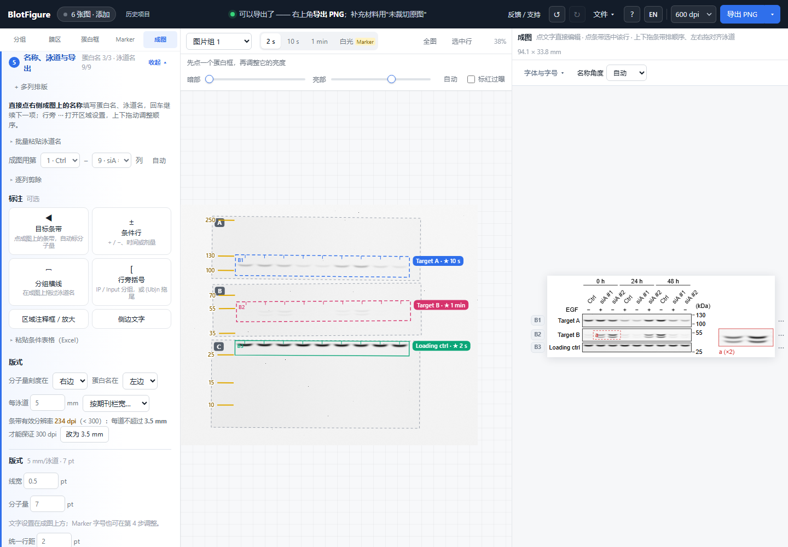

# 桌面成图编辑（0.14.0）

[English](desktop-editing.md) · [返回说明](../README.zh-CN.md)

以下功能已包含在 v0.14.0。WB 的五步流程、独立曝光/亮度、局部泳道识别、Marker 手工标注和排序方式维持原样。

## 字体和名称格式

成图上方点“字体与字号”，可选 Arial、Times New Roman、Helvetica、Calibri、Cambria，并设置全局、泳道名和蛋白名的字号。字体使用本机已安装字体，缺少时由系统替代，不下载字体。

可在同一菜单开启泳道名统一斜体；单独设为正体的文字仍保留正体。

“名称角度”默认自动。切换自定义后，用滑块或数值输入 0–90°；拖动过程实时预览，松手只记录一次撤销。

点成图中的名称直接输入。选中文字后可设正体、斜体、上标、下标和红色；不选择时作用于整个名称。“清除格式”恢复普通字形。泳道名默认统一，可勾选“仅此泳道名设置”，取消后恢复跟随全局。Marker 字号仍统一。

编辑内 Ctrl/⌘+Z 撤销、Ctrl/⌘+Shift+Z 重做，Escape 放弃本次文字及格式修改。中文输入法选字时的回车不会跳到下一项。

## 区域注释框和局部放大

第 5 步点击“区域注释框 / 放大”，在右侧成图的一条蛋白区域内拖出矩形。它是标注工具，不会改变用于裁切/识别的蛋白框。

- 可填标签、选虚线/实线、改字号及默认/红色。
- 拖框线移动，拖右下角手柄调整大小。
- 选择 ×2、×3 或 ×4，在当前列右侧展示同一区域的放大图。它沿用该蛋白所选的曝光和亮度，不生成另一套处理结果。
- 隐藏的来源泳道不会在放大图中偷偷接回；可见的不同片段保留分隔。
- 改裁切后只显示仍在当前可见区域内的注释；排序、跨列及保存恢复继续跟随对应蛋白。
- 放大不增加原图细节，导出前的有效分辨率检查会计入放大倍率。

选中注释可删除或按退格，蛋白区域不会一同删除；撤销可以恢复。

## 侧边文字和括号

“侧边文字”可填写 `IB: anti-HA`、`IP: Flag` 等说明。当前选中的蛋白可绑定自己的标签；没有选中时标注当前排版列。可放左、右或成图下方，支持竖排、颜色和字体格式，在图上拖动微调位置。

行旁括号的两个端点有小手柄，鼠标移上去即可拖动修改覆盖范围，无需删除重画。原有竖排、直线、IP/Input 等用法继续保留。

## 导出与保存

PNG、TIFF、SVG、可编辑 PPT 保留文字格式与颜色。纯灰度成图仍导出灰度 TIFF；使用红色标注时，TIFF 自动采用 RGB 存储标注颜色，原始 WB 像素处理方式不变。

PPT 中字体、上下标、线条和文字仍可编辑；蛋白图及局部放大继续使用原生裁切并保留完整的处理后图片。它不等同于原始 TIFF。更改 PPT 裁切后，标注需自行对齐。

项目/历史保存全部新字段及原始图片，样式模板按蛋白顺序和相对位置复用注释。跨设备继续编辑，请保存 `.blotfig`。

## 更新、反馈与支持

开始页、文件菜单和帮助里可查看本地更新历史，离线也能看。每个新版本只显示一次非阻塞提示。

顶栏“反馈 / 支持”无需导入图片即可打开。在线反馈仅提交填写的文字、可选回复邮箱和版本；不自动附加原图、项目、文件名或泳道名。提交失败保留内容；离线可填写和复制，再去网页版发送。

支持作者与 GitHub Star 都是自愿的，不影响任何功能。成功导出后的提示可关闭；保存支持二维码不会替换刚导出的成图。
