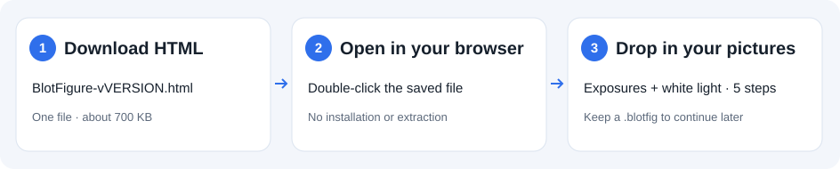

# Download one file and start making figures

For the `0.14.0` desktop controls, see [typography, annotations and insets](desktop-editing.md). The download links below include these controls.

[中文说明](getting-started.zh-CN.md) · [Back to the project](../README.md)

**On a computer, you need just one HTML file. No installation, ZIP extraction or GitHub account.**

## 1. Download

**[Download BlotFigure-v0.14.0.html](https://github.com/poplarity/BlotFigure/releases/download/v0.14.0/BlotFigure-v0.14.0.html)** and save it to your Desktop or Downloads folder.

This is the complete tool, about 700 KB. The interface, styles and image-processing code are all inside the same file.

If you arrive at the [GitHub release page](https://github.com/poplarity/BlotFigure/releases/latest):

1. Find **Assets** and expand it if needed.
2. Click **BlotFigure-vVERSION.html**.
3. Wait for the download to finish, then find it in your computer's Downloads folder.

**Do not choose `Source code (zip)`, `Source code (tar.gz)` or the repository's `index.html`.** Those are source files, rather than the complete single-file version.

## 2. Open in your browser

- **Windows:** double-click the downloaded file. If it opens in a text or code editor, right-click → **Open with** → Edge, Chrome or Firefox.
- **Mac:** double-click the downloaded file. If a browser does not open, right-click → **Open With** → Safari, Chrome or Firefox.

Click **Try the example** to explore the tool. For future sessions, open the same file again; no further download or internet connection is required. The interface follows your browser's language; switch with **EN / 中文** at the top right.

## 3. Drop in your pictures and export

1. Drag **all pictures of one experiment** into the window at once (or click **Choose pictures**): every exposure of each membrane (`.tif` from the imager is best) and one picture that shows the marker — the white-light picture, or white light merged with chemiluminescence.
2. Follow the **5 steps** on the left: confirm the marker picture → check the strips → adjust the protein boxes → mark the ladder bands → names. Each step can be corrected by hand; click **Next** when it is right.
3. Type the protein and lane names on the figure on the right. Add target-band arrows, conditions, groups or side brackets if needed.
4. Click **Export PNG**, review the pre-flight check, and save the image. TIFF, SVG, the uncropped originals and the processing log are in the menu beside the export button.

## Save, update and share

**Save progress:** before closing, choose **File → Save project**. The `.blotfig` file contains all the pictures and every adjustment. Next time choose **File → Open project**. Your browser's "Save page" command does not save your figure-editing session.

**Update:** download the new HTML from Releases. Save your project in the old version first, then open it in the new version. Offline HTML files do not update themselves.

**Share:** send the `BlotFigure-vVERSION.html` file to a colleague with "Save this to your computer and open it in your browser." A messaging app's attachment preview may not run the tool.

**Phones and tablets:** BlotFigure is made for a computer with a mouse; there is no phone layout yet.

## If something looks wrong

| What you see | What to do |
|---|---|
| Plain text and buttons without the normal layout | Styles have not applied. Check that you downloaded `BlotFigure-vVERSION.html`; for the online version, hard-refresh first. The single-file version needs no separate CSS or JS folders. |
| `index.html` inside a ZIP does not work | Download the single HTML instead. To use the ZIP, **extract everything first**; do not open it inside the archive or extract only `index.html`. |
| A text editor, source code or attachment preview opens | Save the file to your computer, then right-click → Open with → choose your browser. |
| You cannot find the downloaded file | Check your browser's download list and your computer's Downloads folder. Make sure the download has finished. |
| Your last figure is not restored after a reload | Drafts depend on browser storage permissions (some browsers block them for local files). Save a `.blotfig` project explicitly and reopen it. |

Hard-refresh the website with **Ctrl+Shift+R** on Windows or **Command+Shift+R** on Mac. For a bug report, include your browser version, whether you opened a URL or a local file, the file name, and a screenshot. You do not need to publish your experimental pictures.
