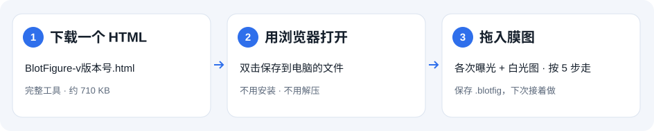

# 下载一个文件，开始做图

`0.14.0` 的字体、标注和局部放大见[桌面编辑说明](desktop-editing.zh-CN.md)。下方下载的版本已包含这些功能。

[English](getting-started.md) · [返回项目介绍](../README.zh-CN.md)

**电脑用户只需要一个 HTML 文件，不用安装、不用解压、不用注册 GitHub。**

## 1. 下载

**[点击下载 BlotFigure-v0.14.0.html](https://github.com/poplarity/BlotFigure/releases/download/v0.14.0/BlotFigure-v0.14.0.html)**，保存到桌面或"下载"文件夹。

这是完整的工具，约 700 KB。网页界面、样式和图像处理代码都已经装在这个文件里。

如果你打开的是 [GitHub 版本下载页](https://github.com/poplarity/BlotFigure/releases/latest)：

1. 找到 **Assets（附件）**，没展开就点一下。
2. 点击 **BlotFigure-v版本号.html**。
3. 等待浏览器下载完成，再到电脑的"下载"文件夹找它。

**不要选 `Source code (zip)`、`Source code (tar.gz)` 或仓库里的 `index.html`。** 这些是源码入口，不是给普通用户准备的单文件版。

## 2. 用浏览器打开

- **Windows：** 双击文件即可。如果打开的是记事本或代码编辑器，右键文件 → **打开方式** → 选择 Edge、Chrome 或 Firefox。
- **Mac：** 双击文件即可。如果没有打开浏览器，右键文件 → **打开方式** → 选择 Safari、Chrome 或 Firefox。

首次打开后可以点 **"看看示例"**，先熟悉操作。以后仍然双击这个文件打开，不需要重新下载，也不需要联网。界面语言跟随浏览器，右上角 **EN / 中文** 可以切换。

## 3. 拖入图片并导出

1. 把**一次实验的全部图片**一起拖进窗口（或点 **选择图片**）：每张膜的各次曝光（最好用成像仪导出的 `.tif`），加上一张看得见 Marker 的图——白光图，或白光 + 化学发光的复合图。
2. 按左边的 **5 步**走：确认 Marker 图 → 检查膜条 → 调整蛋白框 → 标 Marker → 填名称。每一步都可以手动改，确认无误后点 **下一步**。
3. 在右侧成图上填蛋白名和泳道名。需要时添加目标条带箭头、条件行、分组或行旁括号。
4. 点 **导出 PNG**，看过导出前检查后保存图片。TIFF、SVG、未裁切原图和处理日志在导出按钮旁的菜单里。

## 保存、更新和分享

**保存工作进度：** 关闭前点 **文件 → 保存项目**，得到 `.blotfig` 文件；它包含全部图片和所有调整。下次打开 BlotFigure，点 **文件 → 打开项目** 即可继续。不要用浏览器的"保存网页"来保存编辑进度。

**更新：** 在版本下载页下载新的 HTML 文件。先用旧版保存项目，再用新版打开项目。离线文件不会自己升级。

**发给同事：** 直接发送 `BlotFigure-v版本号.html` 文件，并附一句"保存到电脑，用浏览器打开即可"。在微信等软件里预览 HTML 附件，不等于已在浏览器运行。

**手机、平板：** BlotFigure 是为电脑和鼠标设计的，暂时没有手机布局。

## 打开不对时，先看这里

| 看到的情况 | 怎么处理 |
|---|---|
| 一页文字和按钮挤在一起，没有正常排版 | 样式没有生效。请确认下载的是 `BlotFigure-v版本号.html`；如果是在线版，先强制刷新。单文件版不依赖旁边的 CSS/JS 文件夹。 |
| 下载的是 ZIP，打开里面的 `index.html` 不正常 | 建议改下单文件 HTML。若继续使用 ZIP，请先**完整解压**；不要在压缩包内直接打开 HTML，也不要只拖出 `index.html`。 |
| 打开的是记事本、代码或聊天软件预览 | 保存附件到电脑，右键 → 打开方式 → 选择浏览器。 |
| 没有找到下载文件 | 查看浏览器下载列表或电脑的"下载"文件夹，确认下载已完成。 |
| 刷新后没有恢复上次的图 | 本地草稿依赖浏览器权限（有些浏览器对本地文件禁用）。请主动保存 `.blotfig` 项目，并从项目文件恢复。 |

在线强制刷新：Windows 按 **Ctrl+Shift+R**，Mac 按 **Command+Shift+R**。仍然异常时，反馈浏览器版本、打开的是网址还是本地文件、文件名及截图即可，不必公开实验图片。
